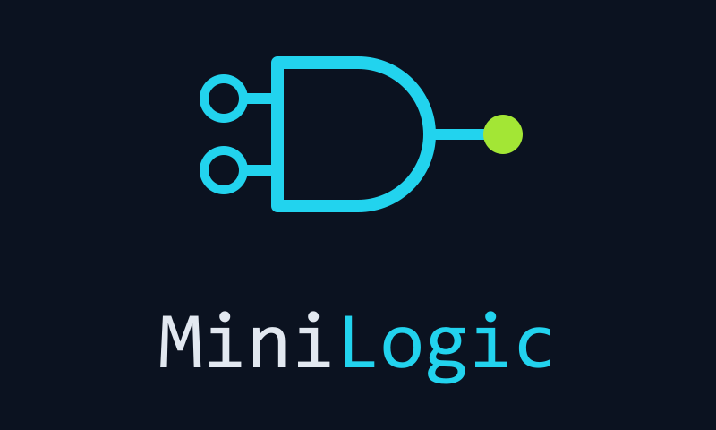
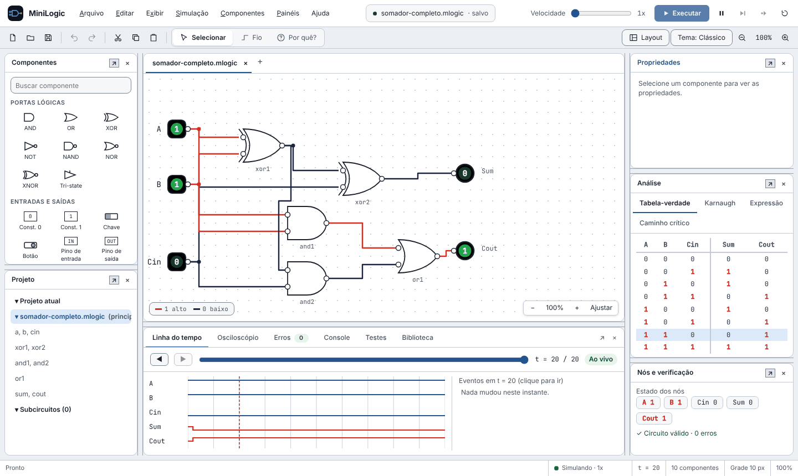
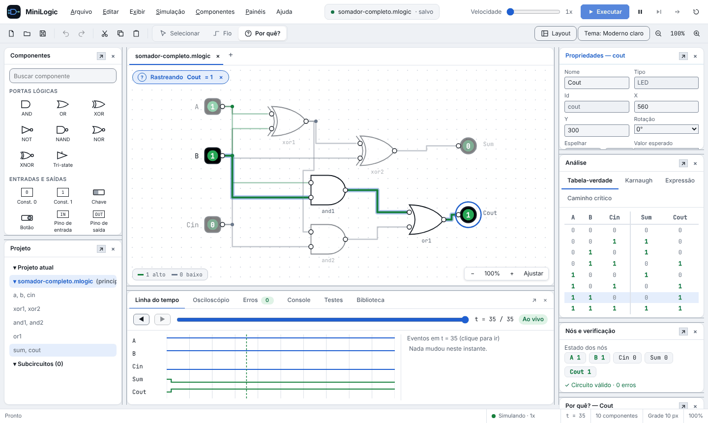
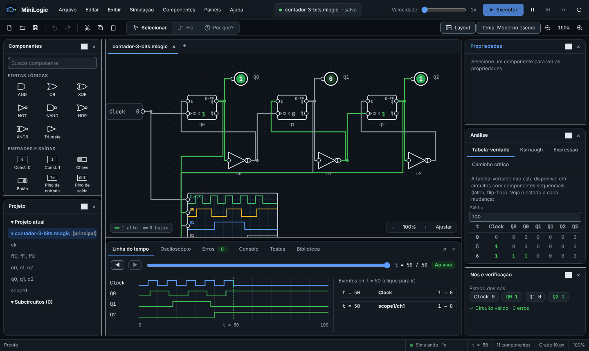
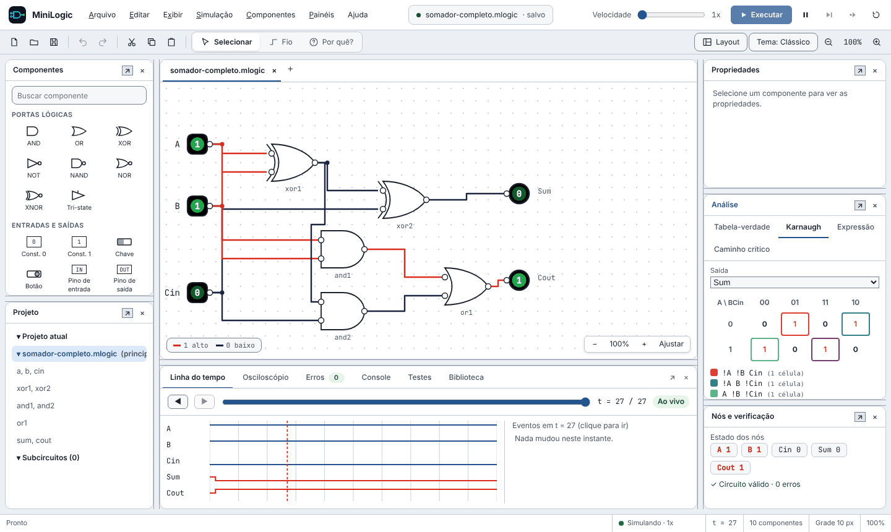
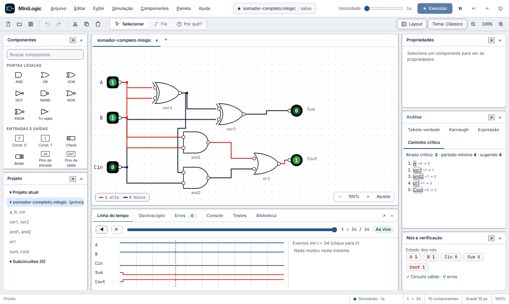
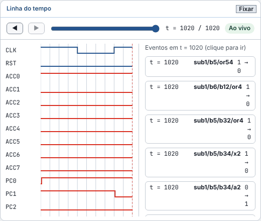
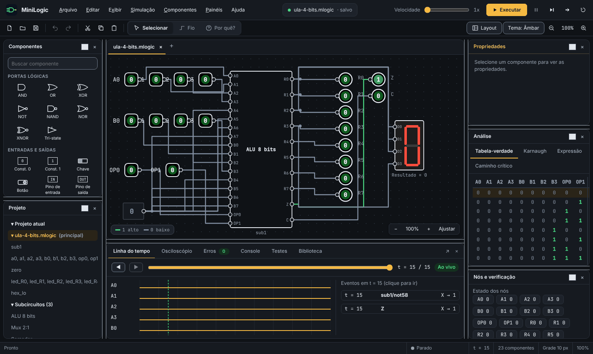
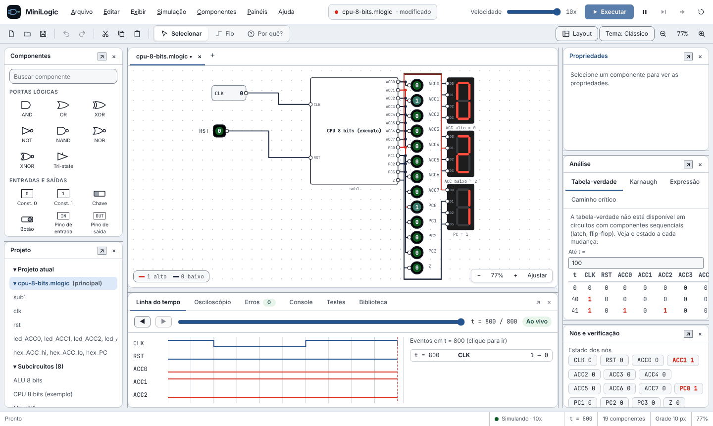
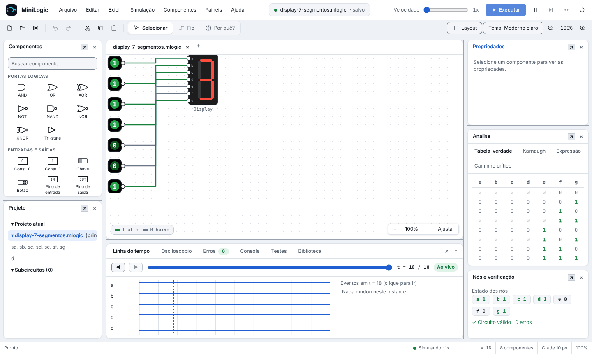

<p align="center"></p>

<p align="center">
  🇧🇷 <a href="README.md">Português</a> · 🇺🇸 <b>English</b>
</p>

# MiniLogic: downloads

**MiniLogic** is a digital circuit editor and simulator for **Windows** and **Linux**. You build the circuit on a schematic, flip the switches and watch the signal propagate. The program also **explains why each output has the value it has** ("Why?") and lets you **go back in time** through the event timeline.

This repository holds **the download files only**, in the [**Releases**](../../releases) tab. The source code is not published here.

[](../../releases/latest)
[](../../releases)



> **Note:** the application interface is currently available in **Portuguese only**. The screenshots below show it as it is.

## Contents

- [Download and install](#download-and-install)
- [Windows warning (SmartScreen)](#windows-warning-smartscreen)
- [Getting started](#getting-started)
- [What MiniLogic does](#what-minilogic-does)
- [Built-in examples](#built-in-examples)
- [Most used shortcuts](#most-used-shortcuts)
- [Files and export](#files-and-export)
- [What's new in 0.5.0](#whats-new-in-050)
- [Known limitations](#known-limitations)
- [Issues and suggestions](#issues-and-suggestions)
- [License](#license)

## Download and install

Open the [**latest release**](../../releases/latest) and download the file for your system (under *Assets*). All builds are for 64-bit computers (x64).

| System | File | What it is |
|---|---|---|
| Windows | `MiniLogic-Setup-X.Y.Z.exe` | **Installer.** Installs the program and creates a shortcut. Best for everyday use. |
| Windows | `MiniLogic-X.Y.Z-portable.exe` | **Portable.** Runs directly with no installation (handy for a USB stick or a PC where you can't install software). |
| Linux | `MiniLogic-X.Y.Z-linux-x86_64.AppImage` | **AppImage.** A single file that runs on most distributions. |

`X.Y.Z` is the version number (for example, `0.5.0`).

### Windows

1. Download `MiniLogic-Setup-X.Y.Z.exe` and open it.
2. If the blue Windows warning appears, see [Windows warning](#windows-warning-smartscreen).
3. Follow the installer, then start **MiniLogic** from the shortcut.

To run without installing, download the `portable.exe` and double-click it.

### Linux

```bash
chmod +x MiniLogic-*-linux-x86_64.AppImage
./MiniLogic-*-linux-x86_64.AppImage
```

If the AppImage does not start because FUSE (`libfuse2`) is missing, run it without mounting: `./MiniLogic-*-linux-x86_64.AppImage --appimage-extract-and-run`.

### Verify the download (optional)

On Windows (PowerShell): `Get-FileHash .\MiniLogic-Setup-0.5.0.exe -Algorithm SHA256`  
On Linux: `sha256sum MiniLogic-0.5.0-linux-x86_64.AppImage`

## Windows warning (SmartScreen)

The executables are **not digitally signed yet**, so Windows SmartScreen may show "Windows protected your PC" the first time you run them. To continue, click **More info** and then **Run anyway**. Always download from this Releases page.

## Getting started

1. Open MiniLogic, go to **Ajuda → Guia de uso** (Help → User guide), tab **Exemplos didáticos** (Teaching examples), and open **Somador completo** (Full adder).
2. Click **Executar** (Run). The switches (A, B, Cin) toggle between 0 and 1 when you click them, and the outputs (Sum, Cout) react immediately.
3. Pick the **Por quê?** (Why?) tool and click an output: the path that explains its value is highlighted on the schematic.
4. To draw your own: choose a gate from the **Componentes** palette, use the **Fio** (Wire) tool to connect an output to an input, and **Save** (`Ctrl+S`).

Wire colors: red is high (1), dark blue is low (0) and gray is unknown (X).

## What MiniLogic does

### Draw and simulate

- AND, OR, NOT, NAND, NOR, XOR and XNOR gates (2 to 8 inputs), tri-state buffers, constants, switches, push buttons and a clock.
- D, JK, T and SR flip-flops (with optional asynchronous set/reset) and the D latch.
- 8-bit buses, splitters and mergers, named terminals, free lines and junctions.
- Outputs: LED, 7-segment display, hexadecimal display, **buzzer** (plays a 100 to 4000 Hz tone) and **LED matrix** (2×2 to 8×8).
- Reusable **subcircuits** and component libraries (`.mlib`).
- Per-component propagation delay, **ideal mode** (no delay), event stepping, breakpoints and a restore point.



### Understand the circuit

- **Why?**: shows the chain of events, from the output back to the switches, that led the signal to its current value.
- **Timeline**: rewind the simulation, jump to the previous or next change and see the events at each instant.
- **Oscilloscope and probe** right on the schematic, with up to 8 channels.
- **Truth table**, **Karnaugh map** and **simplified expression** for each output.
- **Critical path**: the slowest combinational path, with each component's delay and a suggested minimum clock period.







### Check your work

- **Circuit tests** (`.mltest`): describe inputs and expected outputs and run them all at once.
- **Expected value** on each output: the LED turns red with "✗ esperado N" (expected N) when the circuit computes something else.
- The **Erros** (Problems) panel reports unconnected pins, combinational loops and other issues.

### Comfortable to use

- **Four themes**: Classic, Modern light, Modern dark and Amber.
- Panels that move between docks and **can leave the window** (↗ button) and come back with **Fixar** (Pin).
- Several circuits in **tabs**, **autosave** with crash recovery, recent files and undo/redo.
- **Keyboard** navigation and accessibility labels.



## Built-in examples

Under **Ajuda → Guia de uso → Exemplos didáticos**, from simplest to most advanced:

| Example | Level |
|---|---|
| Full adder | Beginner |
| Full adder with subcircuits | Beginner |
| 3-bit counter | Intermediate |
| 7-segment display | Intermediate |
| 4-bit ALU | Intermediate |
| 8-bit CPU, explained | Advanced |
| 8-bit CPU with RAM | Advanced |







## Most used shortcuts

Full list in **Ajuda → Atalhos de teclado** (Help → Keyboard shortcuts), or press `F1`.

| Shortcut | Action |
|---|---|
| `Ctrl+N` / `Ctrl+O` / `Ctrl+S` | New, open, save |
| `Ctrl+Z` / `Ctrl+Y` | Undo, redo |
| `Ctrl+C` / `Ctrl+V` / `Ctrl+D` | Copy, paste, duplicate |
| `R` / `M` | Rotate 90°, mirror |
| `Space` | Toggle the selected switch |
| `Tab` / arrows | Walk through and move components |
| `Esc` | Cancel the wire being drawn |
| `F10` / `F9` | Event step / breakpoint |

## Files and export

| Extension | Use |
|---|---|
| `.mlogic` | Circuit (plain-text JSON, with a version number) |
| `.mlib` | Component library (subcircuits) |
| `.mltest` | Circuit tests |

Under **Arquivo** (File) you can export the schematic as **SVG**, **PNG** and **PDF (A4)**, print it, export waveforms as **CSV** or **VCD** (opens in GTKWave and Surfer), and export the circuit as structural **Verilog** (`.v`), ready for Icarus Verilog, Verilator or Yosys.

## What's new in 0.5.0

- Floating panels in their own window, with a pin button.
- Critical path and minimum clock period.
- New outputs: buzzer and LED matrix.
- PDF (A4) export and printing.
- Easier wiring and lines, multi-selection and many usability fixes.

The full history of each version is in the [release notes](../../releases).

## Known limitations

- Available for **Windows and Linux (x64)** only; there is no macOS build.
- Executables are **not digitally signed** (see the [Windows warning](#windows-warning-smartscreen)) and there is **no automatic update**: to update, download the new version here.
- Floating panels are not remembered when you reopen the program, and keyboard shortcuts do not work inside the floating window.
- Verilog export does not carry propagation delays; clocks become input ports.
- The interface is **Portuguese only**.

## Issues and suggestions

Found a bug or have an idea? Open an [issue](../../issues) in this repository. For a bug, include the version, your system (Windows or Linux) and the steps to reproduce it; if you can, attach the `.mlogic` file that triggers it.

## License

MiniLogic is distributed under the **MIT** license. The legal notice ships with the installer.

---

© Gabriel Novaes
