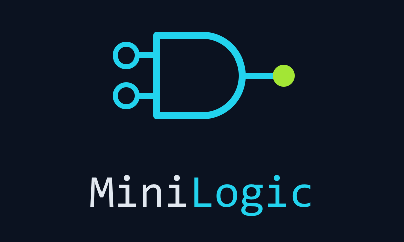
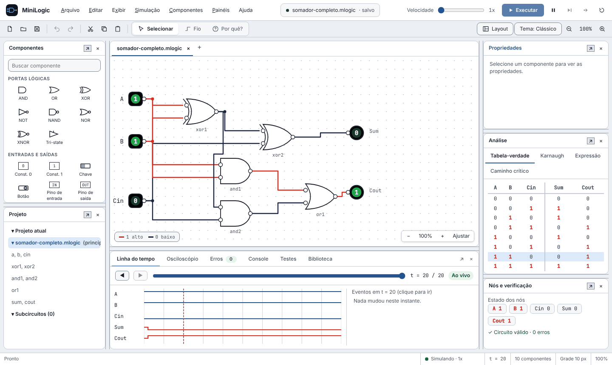
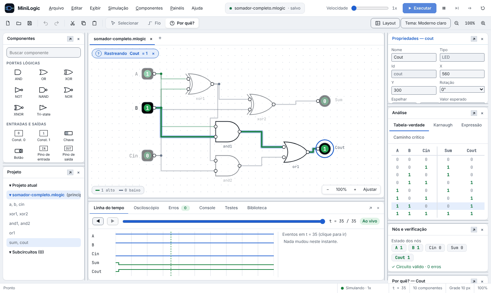
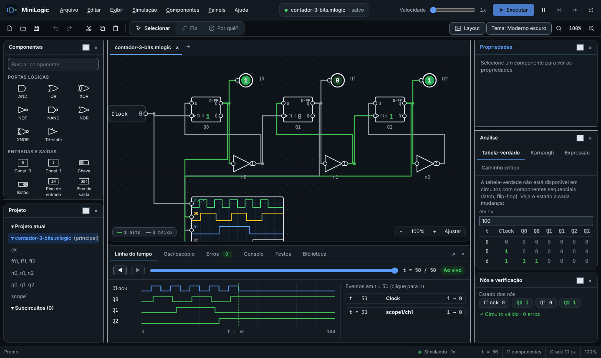
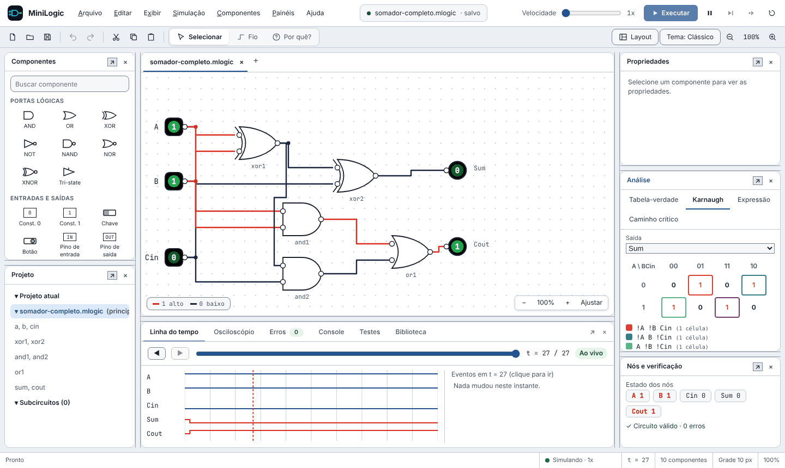
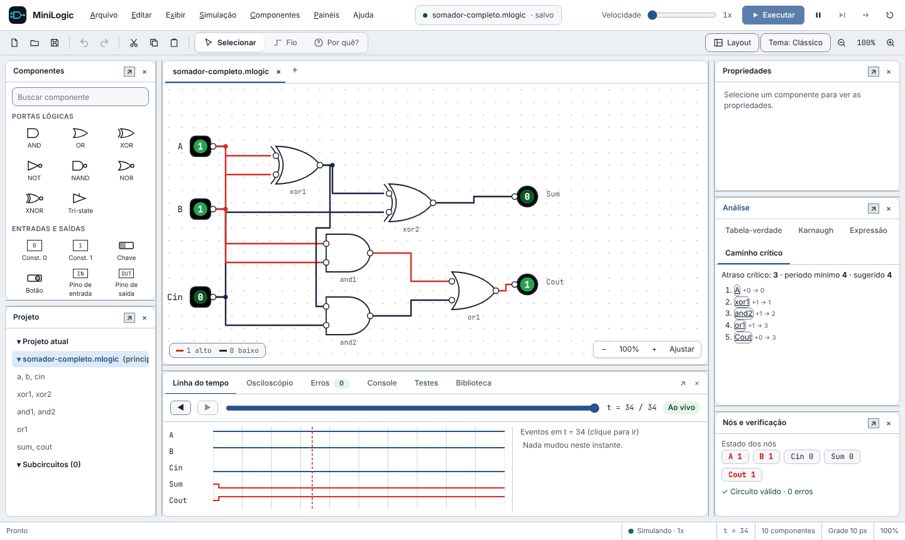
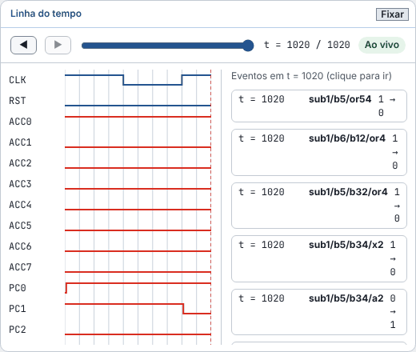
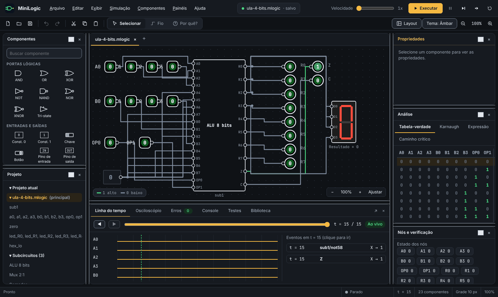
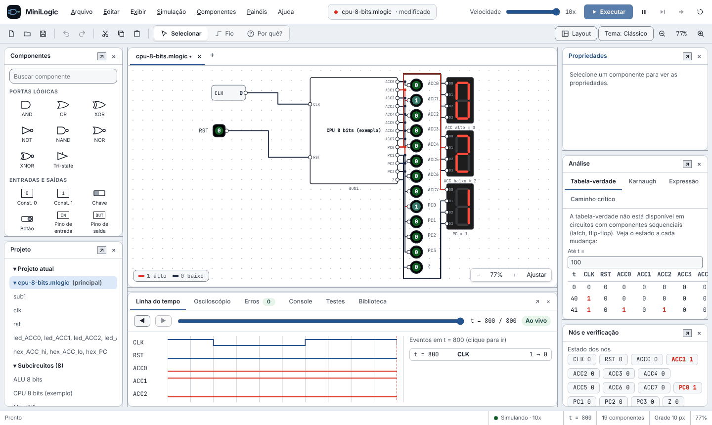
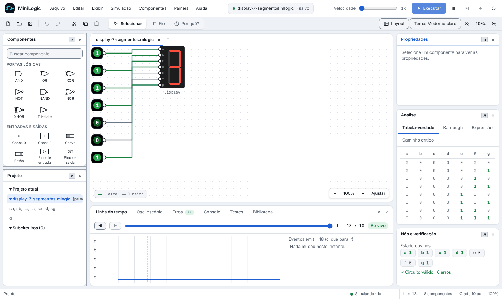

<p align="center"></p>

<p align="center">
  🇧🇷 <b>Português</b> · 🇺🇸 <a href="README.en.md">English</a>
</p>

# MiniLogic: downloads

**MiniLogic** é um editor e simulador de circuitos digitais para **Windows** e **Linux**. Você monta o circuito no esquema, liga as chaves e vê o sinal se propagar, e o programa **explica por que cada saída tem o valor que tem** ("Por quê?") e deixa **voltar no tempo** pela linha de eventos.

Este repositório guarda **somente os arquivos para baixar**, na aba [**Releases**](../../releases). O código-fonte não é publicado aqui.

[](../../releases/latest)
[](../../releases)



## Sumário

- [Baixar e instalar](#baixar-e-instalar)
- [Aviso do Windows (SmartScreen)](#aviso-do-windows-smartscreen)
- [Primeiros passos](#primeiros-passos)
- [O que o MiniLogic faz](#o-que-o-minilogic-faz)
- [Exemplos prontos](#exemplos-prontos)
- [Atalhos mais usados](#atalhos-mais-usados)
- [Arquivos e exportação](#arquivos-e-exportação)
- [Novidades da versão 0.5.0](#novidades-da-versão-050)
- [Limitações conhecidas](#limitações-conhecidas)
- [Problemas e sugestões](#problemas-e-sugestões)
- [Licença](#licença)

## Baixar e instalar

Abra a [**versão mais recente**](../../releases/latest) e baixe o arquivo do seu sistema (em *Assets*). Todos são para computadores de 64 bits (x64).

| Sistema | Arquivo | O que é |
|---|---|---|
| Windows | `MiniLogic-Setup-X.Y.Z.exe` | **Instalador.** Instala o programa e cria o atalho. Indicado para uso diário. |
| Windows | `MiniLogic-X.Y.Z-portable.exe` | **Portátil.** Roda direto, sem instalar (serve para pen drive ou computador sem permissão de instalação). |
| Linux | `MiniLogic-X.Y.Z-linux-x86_64.AppImage` | **AppImage.** Um arquivo só, roda na maioria das distribuições. |

`X.Y.Z` é o número da versão (por exemplo, `0.5.0`).

### Windows

1. Baixe `MiniLogic-Setup-X.Y.Z.exe` e abra o arquivo.
2. Se aparecer o aviso azul do Windows, veja [Aviso do Windows](#aviso-do-windows-smartscreen).
3. Siga o instalador. Depois, abra o **MiniLogic** pelo atalho.

Para usar sem instalar, baixe o `portable.exe` e dê dois cliques.

### Linux

```bash
chmod +x MiniLogic-*-linux-x86_64.AppImage
./MiniLogic-*-linux-x86_64.AppImage
```

Se o AppImage não abrir por falta de FUSE (`libfuse2`), rode-o sem montar: `./MiniLogic-*-linux-x86_64.AppImage --appimage-extract-and-run`.

### Conferir o arquivo baixado (opcional)

No Windows (PowerShell): `Get-FileHash .\MiniLogic-Setup-0.5.0.exe -Algorithm SHA256`  
No Linux: `sha256sum MiniLogic-0.5.0-linux-x86_64.AppImage`

## Aviso do Windows (SmartScreen)

Os executáveis **ainda não têm assinatura digital**. Por isso o Windows SmartScreen pode mostrar "O Windows protegeu o seu computador" na primeira execução. Para continuar: clique em **Mais informações** e depois em **Executar assim mesmo**. Baixe sempre desta página de Releases.

## Primeiros passos

1. Abra o MiniLogic e vá em **Ajuda → Guia de uso**, aba **Exemplos didáticos**, e abra o **Somador completo**.
2. Clique em **Executar**. As chaves (A, B, Cin) alternam entre 0 e 1 quando você clica nelas, e as saídas (Sum, Cout) reagem na hora.
3. Escolha a ferramenta **Por quê?** e clique numa saída: o caminho que explica o valor dela fica destacado no esquema.
4. Para desenhar o seu: escolha uma porta na paleta **Componentes**, use a ferramenta **Fio** para ligar uma saída a uma entrada e **Salvar** (`Ctrl+S`).

Cores dos fios: vermelho é nível alto (1), azul-escuro é baixo (0) e cinza é desconhecido (X).

## O que o MiniLogic faz

### Desenhar e simular

- Portas AND, OR, NOT, NAND, NOR, XOR e XNOR (com 2 a 8 entradas), tri-state, constantes, chaves, botões e clock.
- Flip-flops D, JK, T e SR (com set/reset assíncronos opcionais) e latch D.
- Barramentos de 8 bits, divisores e junções, terminais nomeados, linhas livres e nós.
- Saídas: LED, display de 7 segmentos, display hexadecimal, **buzzer** (toca um tom de 100 a 4000 Hz) e **matriz de LEDs** (2×2 a 8×8).
- **Subcircuitos** reutilizáveis e bibliotecas de componentes (`.mlib`).
- Atraso de propagação por componente, **modo ideal** (sem atraso), passo por evento, pontos de parada e ponto de restauração.



### Entender o circuito

- **Por quê?**: mostra a cadeia de eventos, da saída até as chaves, que levou o sinal ao valor atual.
- **Linha do tempo**: rebobine a simulação, salte para a mudança anterior ou seguinte e veja os eventos de cada instante.
- **Osciloscópio e sonda** direto no esquema, com até 8 canais.
- **Tabela-verdade**, **mapa de Karnaugh** e **expressão simplificada** de cada saída.
- **Caminho crítico**: o trecho combinacional mais lento, com o atraso de cada componente e o período mínimo sugerido para o clock.







### Verificar

- **Testes de circuito** (`.mltest`): descreva entradas e saídas esperadas e rode tudo de uma vez.
- **Valor esperado** em cada saída: o LED fica vermelho com "✗ esperado N" quando o circuito calcula outro valor.
- Painel **Erros** aponta pino sem ligação, laço combinacional e outros problemas.

### Trabalhar com conforto

- **Quatro temas**: Clássico, Moderno claro, Moderno escuro e Âmbar.
- Painéis que trocam de lugar e **podem sair da janela** (botão ↗) e voltar com **Fixar**.
- Vários circuitos em **abas**, **salvamento automático** com recuperação após falha, arquivos recentes e desfazer/refazer.
- Navegação pelo **teclado** e rótulos de acessibilidade.



## Exemplos prontos

Em **Ajuda → Guia de uso → Exemplos didáticos**, do mais simples ao mais avançado:

| Exemplo | Nível |
|---|---|
| Somador completo | Iniciante |
| Somador com subcircuitos | Iniciante |
| Contador de 3 bits | Intermediário |
| Display de 7 segmentos | Intermediário |
| ULA de 4 bits | Intermediário |
| CPU de 8 bits explicada | Avançado |
| CPU de 8 bits com RAM | Avançado |







## Atalhos mais usados

Lista completa em **Ajuda → Atalhos de teclado** (ou `F1`).

| Atalho | Ação |
|---|---|
| `Ctrl+N` / `Ctrl+O` / `Ctrl+S` | Novo, abrir, salvar |
| `Ctrl+Z` / `Ctrl+Y` | Desfazer, refazer |
| `Ctrl+C` / `Ctrl+V` / `Ctrl+D` | Copiar, colar, duplicar |
| `R` / `M` | Girar 90°, espelhar |
| `Espaço` | Alternar a chave selecionada |
| `Tab` / setas | Percorrer e mover componentes |
| `Esc` | Cancelar o fio em andamento |
| `F10` / `F9` | Passo por evento / ponto de parada |

## Arquivos e exportação

| Extensão | Uso |
|---|---|
| `.mlogic` | Circuito (JSON em texto, com número de versão) |
| `.mlib` | Biblioteca de componentes (subcircuitos) |
| `.mltest` | Testes de circuito |

Em **Arquivo** você exporta o esquema como **SVG**, **PNG** e **PDF (A4)**, imprime, exporta as formas de onda em **CSV** ou **VCD** (abre no GTKWave e no Surfer) e exporta o circuito como **Verilog** estrutural (`.v`), pronto para Icarus Verilog, Verilator ou Yosys.

## Novidades da versão 0.5.0

- Painéis flutuantes em janela própria, com botão de fixar.
- Caminho crítico e período mínimo do clock.
- Novas saídas: buzzer e matriz de LEDs.
- Exportação em PDF (A4) e impressão.
- Ligações e linhas mais fáceis de fazer, seleção múltipla e várias correções de usabilidade.

O histórico completo de cada versão está nas [notas de cada release](../../releases).

## Limitações conhecidas

- Disponível para **Windows e Linux (x64)**; não há versão para macOS.
- Executáveis **sem assinatura digital** (veja o [aviso do Windows](#aviso-do-windows-smartscreen)) e **sem atualização automática**: para atualizar, baixe a nova versão aqui.
- Painéis flutuantes não são lembrados ao reabrir o programa, e os atalhos de teclado não funcionam dentro da janela solta.
- A exportação para Verilog não leva os atrasos de propagação; clocks viram portas de entrada.
- A interface está **somente em português**.

## Problemas e sugestões

Encontrou um erro ou tem uma ideia? Abra uma [issue](../../issues) neste repositório. Se for um erro, conte a versão, o sistema (Windows ou Linux) e os passos para repetir; se puder, anexe o arquivo `.mlogic` que o causa.

## Licença

O MiniLogic é distribuído sob a licença **MIT**. O aviso legal acompanha o instalador.

---

© Gabriel Novaes
